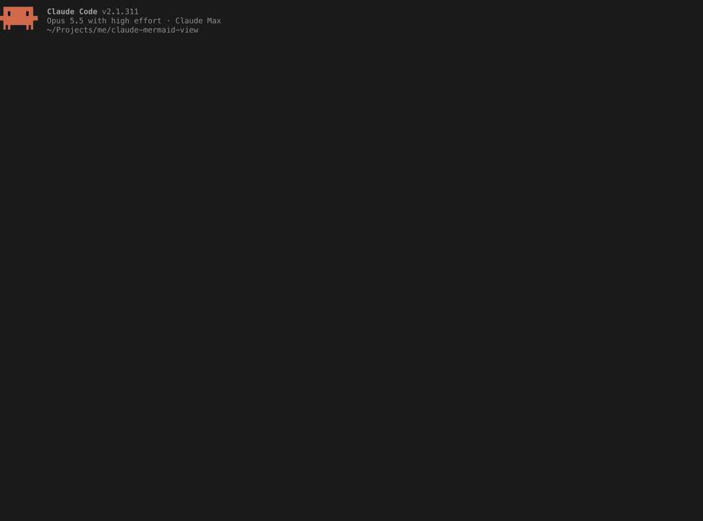
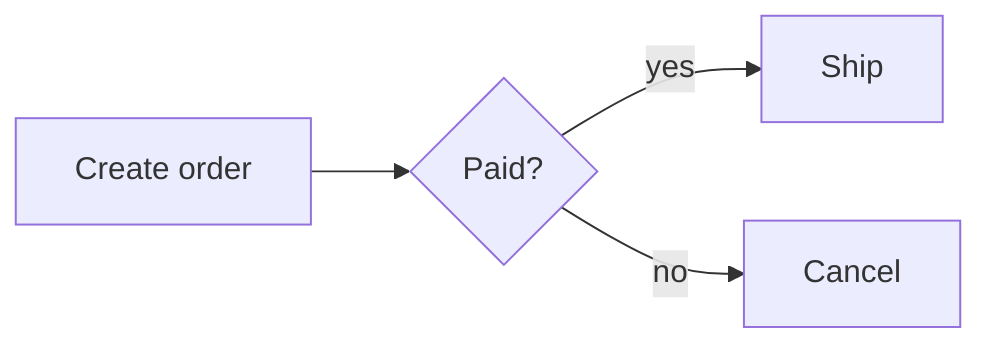
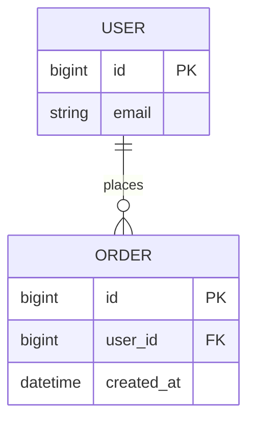

# claude-mermaid-view

[English](README.md) | 한국어

Claude 답변의 ` ```mermaid ` 코드 블록을 터미널 안에서 텍스트 다이어그램으로 그려 주는 [Claude Code](https://claude.com/claude-code) mod입니다. mermaid 원문은 각 다이어그램 아래에 접혀 있어서 클릭 한 번으로 펼칠 수 있습니다.



## 예시

Claude가 이렇게 답하면:

````markdown

````

대화 화면에는 이렇게 나옵니다.

```
┌──────────────┐     ◇───────◇        ┌────────┐
│              │     │       │        │        │
│ Create order ├────►│ Paid? │ ├─yes─►│  Ship  │
│              │     │       │        │        │
└──────────────┘     ◇───┬───◇        └────────┘
                         │
                         │
                         │
                         │
                         │
                         │            ┌────────┐
                         │            │        │
                         └────no─────►│ Cancel │
                                      │        │
                                      └────────┘
▸ show mermaid source  ·  open in mermaid.live
```

ER 다이어그램은 컬럼, 키, 관계 차수를 그대로 보여 줍니다.

````markdown

````

```
┌─────────────────┐      ┌────────────────────────┐
│ USER            │      │ ORDER                  │
├─────────────────┤      ├────────────────────────┤
│ PK bigint id    ││───○╟│ PK bigint id           │
│    string email │places│ FK bigint user_id      │
└─────────────────┘      │    datetime created_at │
                         └────────────────────────┘
```

한글, 중국어, 일본어 라벨과 이모지는 터미널에서 실제로 차지하는 폭(2칸)으로 배치해서 박스 정렬이 맞습니다.

```
┌────────┐        ┌──────┐
│ 사용자 │        │ 서버 │
└────┬───┘        └───┬──┘
     │                │
     │  로그인 요청   │
     │────────────────▶
     │                │
     │     토큰       │
     ◀╌╌╌╌╌╌╌╌╌╌╌╌╌╌╌╌│
```

(브라우저 글꼴은 이 글자들을 정확히 2칸으로 그리지 않아서 GitHub에서는 이 예시가 어긋나 보일 수 있습니다. 터미널에서는 정렬이 맞습니다.)

인용문이나 목록 안에 있는 블록은 그 자리에 그대로 그려서, 인용문 안에 머뭅니다.

````markdown
> **Retry policy**
>
> ```mermaid
> flowchart LR
>   A[Order] --> B{Paid?}
>   B -->|no| C[Retry once]
> ```
````

> **Retry policy**
>
> ```
> ┌───────┐     ◇───────◇     ┌────────────┐
> │       │     │       │     │            │
> │ Order ├────►│ Paid? ├─no─►│ Retry once │
> │       │     │       │     │            │
> └───────┘     ◇───────◇     └────────────┘
> ```

## 설치

Claude Code 터미널 세션의 프롬프트에서:

```
/plugin install mermaid-view --marketplace jo-minjun/claude-mermaid-view
```

마켓플레이스를 추가할지 물으면 `y`로 답하고 설치 범위를 고릅니다. 셸에서 설치하려면:

```sh
claude plugin install mermaid-view --marketplace jo-minjun/claude-mermaid-view
```

## 사용법

따로 설정할 것은 없습니다. 설치한 뒤부터 답변의 mermaid 블록이 다이어그램으로 그려집니다. 목록이나 인용문 안의 블록도 그 자리에 그려집니다.

- **다이어그램 하나의 원문 보기:** 다이어그램 바로 아래의 `▸ show mermaid source`를 클릭하고, 다시 접으려면 `▾ hide mermaid source`를 클릭합니다. 답변 안의 다이어그램마다 버튼이 따로 있습니다. (클릭하려면 Claude Code의 fullscreen 모드처럼 마우스 입력을 받는 터미널 화면이어야 합니다.)
- **모든 원문 펼치기/접기:** `/mermaid-source`를 실행합니다.
- **mermaid로 그리게 하기 (기본 켜짐):** mod가 시스템 프롬프트로 Claude에게 "다이어그램을 그릴 때는 ASCII 그림 대신 mermaid 블록으로, 이 mod가 그릴 수 있는 종류로 그려라"고 지시합니다. 다이어그램을 더 자주 그리라는 지시는 아니고, 다이어그램에 관한 사용자 자신의 지시가 우선합니다. `/mermaid-prompt`로 끄고 켭니다. 설정은 세션이 바뀌어도 유지되고, 다음 메시지부터 적용됩니다.
- **mermaid.live에서 열기:** 버튼 옆 링크를 누르면 [mermaid.live](https://mermaid.live) 편집기에 다이어그램이 열리고, 거기서 고치거나 SVG/PNG로 내려받을 수 있습니다. 원문은 링크의 `#` 뒷부분(fragment)에 담기는데, 브라우저는 이 부분을 서버로 보내지 않고 페이지가 브라우저 안에서 읽습니다. 인코딩한 길이가 2048자를 넘는 원문에는 링크가 붙지 않습니다.
- **원본 텍스트:** 바뀌는 것은 화면에 그리는 모습뿐입니다. 저장된 메시지와 Claude가 다시 읽는 내용에는 mermaid 원문이 그대로 남습니다.

다음 경우에는 블록을 원문 그대로 둡니다.

- 렌더러가 읽지 못할 때 (지원하지 않는 다이어그램 종류나 문법, 오타)
- 다시 그려 봐도 다이어그램이 터미널보다 넓을 때. flowchart와 state 다이어그램은 간격을 좁혀서, sequence 다이어그램은 메시지 라벨과 참가자 이름을 단어 단위로 줄바꿈해서 다시 그립니다. 자기 자신에게 보내는 메시지는 렌더러가 여러 줄로 그리지 못해서 줄바꿈하지 않습니다.
- 블록이 아직 스트리밍 중일 때 (닫는 펜스가 아직 없음)

## 지원하는 다이어그램

그리기는 [beautiful-mermaid](https://github.com/lukilabs/beautiful-mermaid)의 텍스트 렌더러가 맡습니다. `flowchart`/`graph`, `sequenceDiagram`, `classDiagram`, `erDiagram`, `stateDiagram-v2`, `xychart`를 지원합니다. 다른 종류(`pie`, `gantt`, `mindmap` 등)는 원문 그대로 남습니다.

렌더러에서 오는 알려진 한계:

- 두 박스 사이 간격보다 긴 간선 라벨은 잘립니다 (`ordered in` → `ordere`).
- 간선이 많이 교차하는 큰 그래프는 텍스트로 읽기 어렵습니다.
- flowchart 노드 ID는 ASCII여야 합니다 (`A[주문]`은 되고 `주문[주문]`은 안 됩니다). 라벨은 어떤 언어든 됩니다.
- 여러 코드 포인트로 이루어진 이모지(`❤️`, `👨‍👩‍👧`, 국기, 피부색 조합)는 터미널마다 그리는 폭이 달라서 1칸 어긋날 수 있습니다.

## 동작 방식

mod는 Claude Code의 `AssistantMessage` 행에 대한 `ui.render`를 가로챕니다. 닫힌 mermaid 펜스마다 번들된 렌더러로 원문을 그리고, 바꾼 markdown을 Claude Code의 답변 렌더러에 넘깁니다. 답변은 다이어그램마다 끊어서 조각별로 그리기 때문에, 각 다이어그램의 토글 버튼이 그 바로 아래에 놓입니다.

렌더러는 글자 폭을 JavaScript 문자열 길이로 재기 때문에, 터미널에서 2칸을 차지하는 한글을 1칸으로 셉니다. mod는 그리기 전에 넓은 글자마다 모자란 칸만큼 1칸짜리 채움 글자(U+A4D0)를 붙이고, 출력에서 다시 지웁니다. `😀` 같은 이모지는 문자열 길이가 이미 2라서 채움 글자를 붙이지 않습니다.

## 개발

```sh
claude plugin validate .
claude plugin test .
```

mod 모듈은 npm 패키지를 import할 수 없어서, `hooks/vendor/beautiful-mermaid.js`에 렌더러의 `src/ascii` 진입점을 ES 모듈 하나로 번들해 두었습니다. 렌더러 버그 수정은 `scripts/patches/`에 있고, 번들하기 전에 패키지 소스에 적용됩니다. 다시 만들려면(`npm`과 `bun` 필요):

```sh
scripts/build-vendor.sh 1.1.3
```

## 라이선스

MIT. 번들된 렌더러 beautiful-mermaid도 MIT이고, 라이선스 파일은 `hooks/vendor/`에 있습니다.
