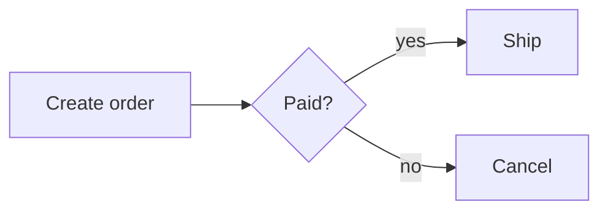
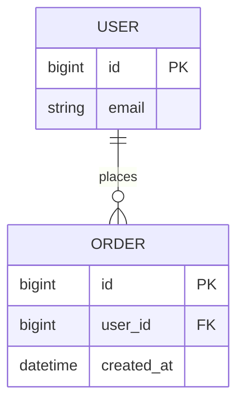

# claude-mermaid-view

A [Claude Code](https://claude.com/claude-code) mod that draws the ` ```mermaid ` code blocks in Claude's replies as text diagrams, right in the terminal. The mermaid source is folded under each diagram, one click away.

## Example

Claude replies with:

````markdown

````

The transcript shows:

```
┌──────────────┐     ◇───────◇        ┌────────┐
│              │     │       │        │        │
│ Create order ├────►│ Paid? │ ├─yes─►│  Ship  │
│              │     │       │        │        │
└──────────────┘     ◇───┬───◇        └────────┘
                         │
                         │
                         │
                         │
                         │
                         │            ┌────────┐
                         │            │        │
                         └────no─────►│ Cancel │
                                      │        │
                                      └────────┘
▸ mermaid 원문 보기
```

ER diagrams keep their columns, keys and cardinality:

````markdown

````

```
┌─────────────────┐      ┌────────────────────────┐
│ USER            │      │ ORDER                  │
├─────────────────┤      ├────────────────────────┤
│ PK bigint id    ││───○╟│ PK bigint id           │
│    string email │places│ FK bigint user_id      │
└─────────────────┘      │    datetime created_at │
                         └────────────────────────┘
```

Korean, Chinese and Japanese labels and emoji are laid out at their real terminal width (two columns), so boxes stay aligned:

```
┌────────┐        ┌──────┐
│ 사용자 │        │ 서버 │
└────┬───┘        └───┬──┘
     │                │
     │  로그인 요청   │
     │────────────────▶
     │                │
     │     토큰       │
     ◀╌╌╌╌╌╌╌╌╌╌╌╌╌╌╌╌│
```

(A browser font may not draw these characters at exactly two columns, so this example can look uneven on GitHub. It lines up in a terminal.)

## Install

At the prompt of a Claude Code terminal session:

```
/plugin install mermaid-view --marketplace jo-minjun/claude-mermaid-view
```

Answer `y` to add the marketplace, then pick a scope. From a shell:

```sh
claude plugin install mermaid-view --marketplace jo-minjun/claude-mermaid-view
```

## Usage

Nothing to set up: mermaid blocks in replies are drawn as diagrams from then on.

- **Show the source of one diagram:** click `▸ mermaid 원문 보기` ("show mermaid source") under it, and `▾ mermaid 원문 접기` ("fold") to hide it again. With several diagrams in one reply the buttons are numbered. (Clicking needs a terminal layout that takes mouse input, such as Claude Code's fullscreen mode.)
- **Show or fold every source:** run `/mermaid-source`.
- **Original text:** only the drawing changes. The stored message and what Claude reads back keep the mermaid source.

A block is left as its source when:

- the renderer cannot read it (a diagram type or syntax it does not support, a typo),
- the diagram is wider than the terminal,
- the block is still streaming (no closing fence yet).

## Supported diagrams

Rendering is done by [beautiful-mermaid](https://github.com/lukilabs/beautiful-mermaid)'s text renderer: `flowchart`/`graph`, `sequenceDiagram`, `classDiagram`, `erDiagram`, `stateDiagram-v2` and `xychart`. Other types (`pie`, `gantt`, `mindmap`, …) stay as source.

Known limits, from the renderer:

- Edge labels longer than the gap between two boxes are cut (`ordered in` → `ordere`).
- Large graphs with many crossing edges get hard to read in text.
- Flowchart node IDs must be ASCII (`A[주문]` works, `주문[주문]` does not); labels can be any language.

## How it works

The mod hooks Claude Code's `ui.render` for `AssistantMessage` rows. For each closed mermaid fence it renders the source with the bundled renderer and passes the rewritten markdown on to Claude Code's own markdown renderer, adding a toggle button under the reply.

The renderer counts every character as one column. To lay out wide characters correctly, the mod appends a one-column filler letter (U+A4D0) after each wide character before rendering and strips it from the output.

## Development

```sh
claude plugin validate .
claude plugin test .
```

`hooks/vendor/beautiful-mermaid.js` is the renderer's `src/ascii` entry bundled into one ES module, because a hooks module cannot import npm packages. To rebuild it (needs `npm` and `bun`):

```sh
scripts/build-vendor.sh 1.1.3
```

## License

MIT. The bundled renderer keeps its own licenses: beautiful-mermaid (MIT) and entities (BSD-2-Clause), in `hooks/vendor/`.
