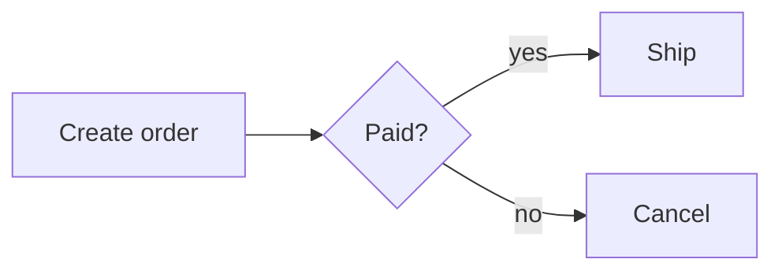
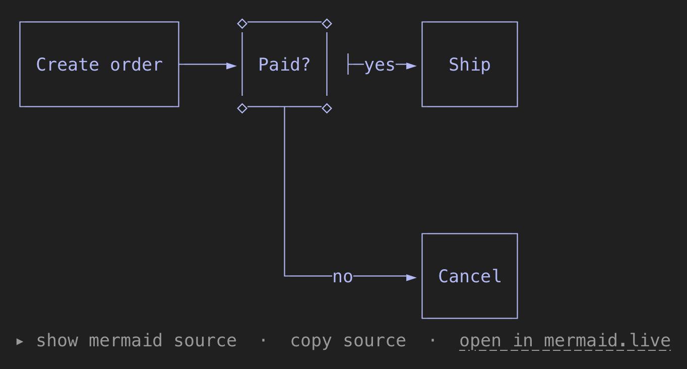
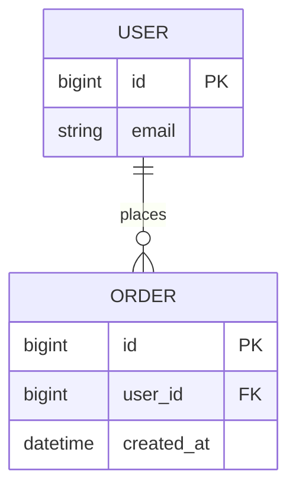
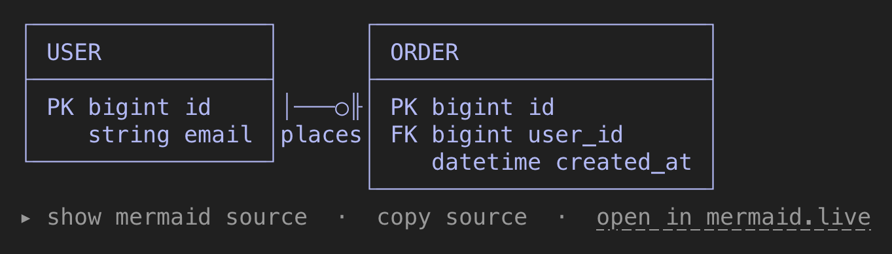
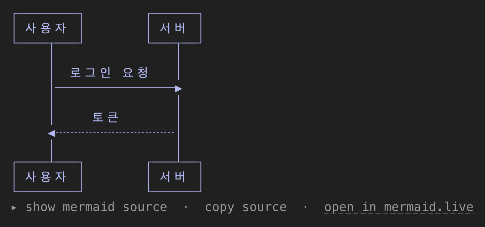
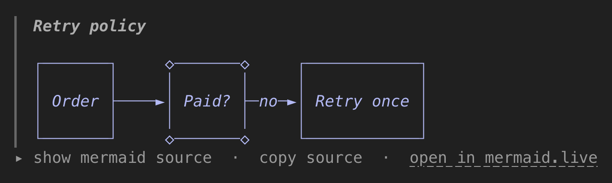

# claude-mermaid-view

English | [한국어](README.ko.md)

A [Claude Code](https://claude.com/claude-code) mod that draws the ` ```mermaid ` code blocks in Claude's replies as text diagrams, right in the terminal. The mermaid source is folded under each diagram, one click away.


## Why

Claude can draw good ASCII diagrams, but they only live in the terminal. They break in docs, PRs and Slack, and changing one means redrawing it. Mermaid is a source you can paste into docs, edit line by line, and feed back to Claude, but in the terminal it is just code. This mod keeps Mermaid as the source and shows it as a picture in the terminal.

## Features

- Draws mermaid flowchart, sequence, class, ER, state and xychart blocks as text diagrams in the transcript
- Fits the terminal: a wide diagram is redrawn with tighter spacing or wrapped labels
- Lines up Korean, Chinese, Japanese and emoji labels at their real terminal width
- Draws blocks inside blockquotes and list items in place
- Under each diagram: show the source, copy it, or open it in mermaid.live
- `/mermaid-source` shows or folds every diagram's source at once
- Asks Claude to draw diagrams as mermaid instead of ASCII art (on by default, `/mermaid-prompt` to toggle)
- Leaves the stored message untouched; only the drawing changes

## Example

Claude replies with:

````markdown

````

The transcript shows:



ER diagrams keep their columns, keys and cardinality:

````markdown

````



Korean, Chinese and Japanese labels and emoji are laid out at their real terminal width (two columns), so boxes stay aligned:



A block inside a blockquote (or a list item) is drawn in place, so it stays inside the quote:

````markdown
> **Retry policy**
>
> ```mermaid
> flowchart LR
>   A[Order] --> B{Paid?}
>   B -->|no| C[Retry once]
> ```
````



## Install

At the prompt of a Claude Code terminal session:

```
/plugin install mermaid-view --marketplace jo-minjun/claude-mermaid-view
```

Answer `y` to add the marketplace, then pick a scope. From a shell:

```sh
claude plugin install mermaid-view --marketplace jo-minjun/claude-mermaid-view
```

## Usage

Nothing to set up: mermaid blocks in replies are drawn as diagrams from then on. Blocks inside a list item or a blockquote are drawn in place.

- **Show the source of one diagram:** click `▸ show mermaid source` right under it, and `▾ hide mermaid source` to fold it again. Each diagram in a reply has its own button. (Clicking needs a terminal layout that takes mouse input, such as Claude Code's fullscreen mode.)
- **Copy the source:** click `copy source` to put the diagram's mermaid source (without the fence) on the clipboard, the way `/copy` does; a toast says whether it worked.
- **Show or fold every source:** run `/mermaid-source`.
- **Diagrams as mermaid by default:** the mod asks Claude, in its system prompt, to draw any diagram as a mermaid block instead of ASCII art, using the diagram types the mod can draw. It does not ask for more diagrams, and your own instructions about diagrams come first. Run `/mermaid-prompt` to turn this off or back on; the choice is kept across sessions and applies from the next message.
- **Open in mermaid.live:** the `open in mermaid.live` link in the same row opens the diagram in the [mermaid.live](https://mermaid.live) editor, where it can be edited or exported as SVG or PNG. The source rides in the link's `#` fragment, which the browser does not send to the server; the page reads it in the browser. A source too long for a link (over 2048 characters once encoded) gets no link.
- **Original text:** only the drawing changes. The stored message and what Claude reads back keep the mermaid source.

A block is left as its source when:

- the renderer cannot read it (a diagram type or syntax it does not support, a typo),
- the diagram is wider than the terminal, even after a retry: a flowchart or state diagram is redrawn with tighter spacing, and a sequence diagram with its message labels and participant names wrapped at word breaks (self-messages are not wrapped, since the renderer cannot draw them on several lines),
- the block is still streaming (no closing fence yet).

A closed block left as source still gets the `copy source` button and the `open in mermaid.live` link under it, so a diagram the renderer cannot draw, or one too wide for the terminal, can be seen in the browser.

## Supported diagrams

Rendering is done by [beautiful-mermaid](https://github.com/lukilabs/beautiful-mermaid)'s text renderer: `flowchart`/`graph`, `sequenceDiagram`, `classDiagram`, `erDiagram`, `stateDiagram-v2` and `xychart`. Other types (`pie`, `gantt`, `mindmap`, …) stay as source, with the copy button and the mermaid.live link under them.

Known limits, from the renderer:

- Edge labels longer than the gap between two boxes are cut (`ordered in` → `ordere`).
- Large graphs with many crossing edges get hard to read in text.
- Flowchart node IDs must be ASCII (`A[주문]` works, `주문[주문]` does not); labels can be any language.
- Emoji made of several code points (`❤️`, `👨‍👩‍👧`, flags, skin tones) can still be off by a column, since terminals draw them at different widths.

## How it works

The mod hooks Claude Code's `ui.render` for `AssistantMessage` rows. For each closed mermaid fence it renders the source with the bundled renderer and passes the rewritten markdown on to Claude Code's own reply renderer. The reply is drawn in pieces split after each diagram, so each diagram's toggle button sits right under it.

The renderer measures text by JavaScript string length, so a Korean character counts as one column though a terminal draws it in two. Before rendering, the mod appends one-column filler letters (U+A4D0) after each wide character to make up the difference, and strips them from the output. An emoji such as `😀` already has a string length of two and gets no filler.

## Development

```sh
claude plugin validate .
claude plugin test .
```

`hooks/vendor/beautiful-mermaid.js` is the renderer's `src/ascii` entry bundled into one ES module, because a hooks module cannot import npm packages. Fixes to the renderer live in `scripts/patches/` and are applied to the package source before bundling. To rebuild it (needs `npm` and `bun`):

```sh
scripts/build-vendor.sh 1.1.3
```

## License

MIT. The bundled renderer, beautiful-mermaid, is also MIT; its license is in `hooks/vendor/`.
